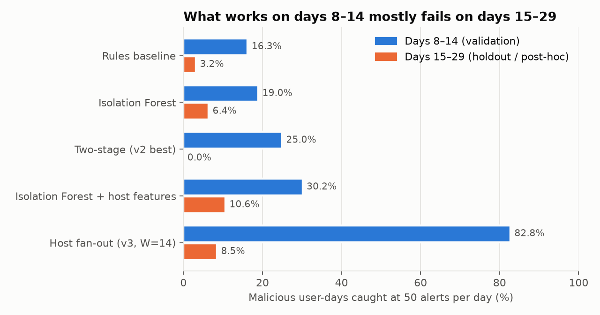
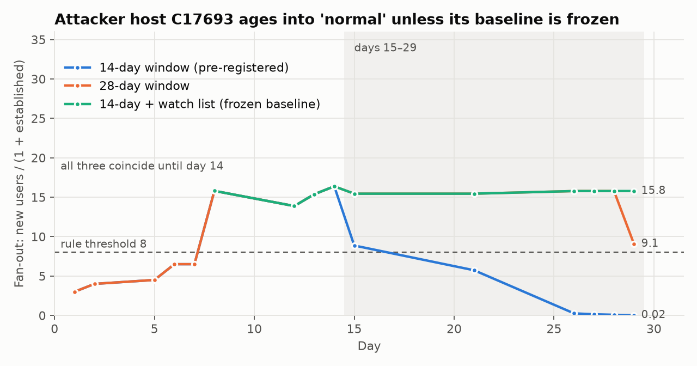
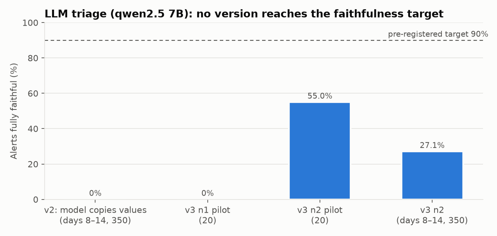

# Entity-Level Behavioral Anomaly Detection & Alert Triage

Detect compromised accounts in enterprise authentication telemetry by baselining each **user's own
behaviour** (and their peers'), then rank user-days for an analyst. The question this project answers
is operational: *at a fixed recall, how many alerts per day does an analyst have to look at, and does
a model beat a simple rule at that?*

## At a glance

**Data:** the LANL authentication logs: 30 days of user logons, 47 to 116 malicious user-days per
evaluation window, from a red-team exercise. Models train on days 0–7 without labels; days 8–14 are for
validation; days 15–29 were a frozen holdout.

**What I built:**
- DuckDB feature pipeline: per-user baselines, peer groups, novelty and host fan-out;
- seven detectors, plus a labelled model as an upper-bound reference;
- leakage tests;
- SHAP evidence packs and LLM triage with a mechanical faithfulness check;
- a detection rule with an analyst runbook ([detections/](detections/RUNBOOK.md)).

**What happened** (each step was pre-registered before it was scored):

| Step | Days 8–14 | Days 15–29 | Verdict |
|---|---|---|---|
| Best v2 detector (two-stage novelty gate) | 25% caught at 50 alerts/day | **0%** | fails the frozen holdout |
| v3 host fan-out (14-day window) | 82.8% | **8.5%** | fails; baseline poisoning |
| Fan-out rule + watch list (designed after seeing days 15–29) | 98% at 64 user alerts/day | 87% at 86 user alerts/day | promising, post-hoc only |
| LLM triage (local 7B model), best version | 27.1% of alerts fully faithful | – | fails the 90% target |



**Why the holdout failed.** The validation attacks were first contacts: a user logging on from a host
for the first time. Most holdout attacks were repeat visits from the same foothold, and novelty
features stop seeing those after the first visit. A host-level view fixes the first part. But with a
14-day memory, the main attacker host's 100+ victims become "established" and its score fades to
almost zero. Freezing a host's baseline once it has fired keeps it visible:



**LLM triage.** A 7B model can't reliably copy numbers or choose verdicts. After a redesign where code
fills every value and the detector keeps the verdict, it still pairs facts with the wrong baselines.
The mechanical checker catches every such error, which is the part worth keeping:



**What's left:** the watch-list rule needs a test on fresh labelled data, because LANL has none after
day 29 (DARPA OpTC is the candidate). An LLM version where code also attaches the baseline can be
tested without labels, on later LANL days.

## Detailed write-ups

The README is the summary. The full record, with every pre-registration kept word for word in the
order it was written (git history shows each was committed before its results), is in `docs/`:

| File | What's in it |
|---|---|
| [00-data-and-method.md](docs/00-data-and-method.md) | Data, features, detectors and metrics |
| [01-baseline-and-v2.md](docs/01-baseline-and-v2.md) | First pass, v2 novelty features and the two-stage gate (days 8–14) |
| [02-holdout.md](docs/02-holdout.md) | Frozen holdout (days 15–29) |
| [03-v3-host-fanout-and-rule.md](docs/03-v3-host-fanout-and-rule.md) | v3 host fan-out and the detection rule (post-hoc) |
| [04-explanations-and-llm-triage.md](docs/04-explanations-and-llm-triage.md) | SHAP explanations and LLM triage |

## Design choices that differ from the usual "classify the flows" project

| Choice | Why |
|---|---|
| Unit of detection = **(user, day)**, not a single event/flow | Analysts triage accounts, not packets. Lateral movement is a *change in an entity's behaviour* (new hosts, NTLM, odd hours), which is invisible row by row. |
| **Rolling per-user baselines** (previous 7 days, today excluded) + **peer-group** deviation | "50 hosts" is normal for an admin and alarming for an accountant. |
| Headline metric = **alerts/day at 80/90% recall** + PR-AUC | Accuracy is meaningless at ~0.1% prevalence; alert volume is the analyst's real cost. |
| Rule/Sigma-style baseline is a first-class competitor | The README will report where the model does **not** win. |
| Labels physically separated (`labels` schema) and only used for evaluation | Unsupervised models must not see labels; tests enforce it. |

## Quick start

```powershell
py -3 -m venv .venv
.\.venv\Scripts\python -m pip install -e ".[dev,models]"   # CPU torch: add --index-url https://download.pytorch.org/whl/cpu
.\run.ps1 pipeline      # synthetic data -> DuckDB -> features   (or: make pipeline)
.\run.ps1 evaluate      # fit on days 0-7, score days 8-14 -> reports/metrics_synthetic_v2.md (--feature-set v1 for the first pass)
.\run.ps1 test
```

Everything is driven by [config/default.toml](config/default.toml) (seed, paths, windows, thresholds).

## Getting the data

**Primary: LANL "Comprehensive, Multi-Source Cyber-Security Events"** (<https://csr.lanl.gov/data/cyber1/>),
`auth.txt.gz` + `redteam.txt.gz`. Read the dataset's terms on that page before downloading.

The files sit behind a short form on that page (email + intended use). Fill it in, then pass the
signed download links it reveals (or paths to files you downloaded by hand) — both options accept either:

```powershell
.\.venv\Scripts\python -m threatdet.data.download_lanl --days 15 --auth-file "<auth.txt.gz link>" --redteam-file "<redteam.txt.gz link>"
.\.venv\Scripts\python -m threatdet.data.download_lanl --days 15 --auth-file D:\lanl\auth.txt.gz --redteam-file D:\lanl\redteam.txt.gz
```

The downloader fetches only the needed prefix over parallel, resumable range requests; details and
the reference run are in [docs/00-data-and-method.md](docs/00-data-and-method.md).

```powershell
.\.venv\Scripts\python -m threatdet.pipeline all --source lanl --db data/lanl.duckdb
```

**Synthetic (development only):** [src/threatdet/data/synthetic.py](src/threatdet/data/synthetic.py)
writes byte-compatible LANL-format files, so the real pipeline runs unchanged. It includes benign
anomalies (admin sweeps, some in a late maintenance window; users on an unfamiliar workstation) and two
attack styles (noisy NTLM bursts to many new hosts vs. stealthy 2-3 host Kerberos moves in office hours).
`scenarios.json` records which is which for error analysis. **Synthetic results are sanity checks, not
evidence**; they are easy by construction.

## Pipeline

```
auth.txt.gz ─▶ sql/01_ingest_auth.sql    ─▶ auth_events                (normalized; '?' -> NULL)
redteam.txt.gz ▶ sql/02_ingest_labels.sql ─▶ labels.redteam_events / redteam_match / user_day
auth_events ─▶ sql/10_user_day_base.sql  ─▶ features.user_day_base     (per user-day aggregates)
            ─▶ sql/11_user_day_baseline.sql ▶ features.user_day_dense / user_day_baseline
            ─▶ sql/12_peer_groups.sql    ─▶ features.peer_groups, features.user_day  (model table)
```

Orchestrated by [src/threatdet/pipeline.py](src/threatdet/pipeline.py); SQL placeholders (`{{name}}`)
are rendered by [sqlrun.py](src/threatdet/sqlrun.py), which fails on any missing *or unused* parameter.

Features, leakage controls (all enforced by tests), detectors and metrics are described in
[docs/00-data-and-method.md](docs/00-data-and-method.md).

## Assumptions & limitations (so far)

* **Timezone:** LANL publishes no timezone; hours are on the dataset clock. `off_hours` was chosen from the
  global hourly volume profile ([details](docs/00-data-and-method.md)), not from labels.
* **Entity scope:** machine accounts (`C123$`) and `ANONYMOUS LOGON` are dropped at ingest to stay
  laptop-sized; red-team rows are attributed to user accounts. Host-level entities are future work.
* **Cold start:** "new host" only knows history inside the ingested window; early days overstate novelty
  for rarely-active users.
* **Label noise:** LANL red-team labels are a partial record of attacker activity; benign-looking days of
  a compromised user may be unlabelled (and vice versa). The match rate of red-team rows to auth rows is
  reported by `ingest` and must be checked on the real data.
* Peer groups from a 3-day warm-up are coarse. The fallback groups (`infra_only`, `no_remote`) are
  large and mixed, so their peer z-scores are weaker. The infrastructure host list is fixed from days
  0–2, so servers that only become shared later are missed.
* A late-arriving account whose first 3 days are already malicious gets anchored on the attacker's
  targets. The self-baseline has the same cold-start problem.

## Repository layout

```
config/       default.toml (single source of parameters)
sql/          ingestion + feature SQL (DuckDB)
src/threatdet/  config, sqlrun, pipeline, metrics, evaluate, freeze, models/detectors, data/{download_lanl, synthetic}
triage/       explain (SHAP evidence packs), llm (v2 triage + faithfulness check), narrate (v3: LLM narrates, code fills values); outside the frozen tree
hostrisk/     v3 host fan-out + recency features and evaluation (post-hoc); outside the frozen tree
detections/   host fan-out rule with watch list (SQL), runner + scoring, analyst RUNBOOK.md; outside the frozen tree
docs/         the full write-ups (00-04), make_figures.py and the README figures
.github/      CI: freeze check + test suite on every push
tests/        pytest suite (109 tests, offline, ~1 min)
notebooks/    exploration (to come)
reports/      metrics_<source>_<v1|v2>.{json,md}, evidence_*.jsonl, explanations_*.{json,md}; figures + recommendations write-up (to come)
```

## Roadmap

1. ~~Ingest~~ · 2. ~~Features~~ · 3. ~~Models~~ (rules, z-score max, Isolation Forest, autoencoder,
   supervised ceiling; scikit-learn gradient boosting stands in for XGBoost to avoid a dependency) ·
   4. ~~Time split, PR-AUC, recall@k, alerts/day, bootstrap CIs~~; ~~event-level novelty (v2)~~; ~~two-stage gate~~; ~~frozen holdout days 15–29~~ (failed; see [docs/02-holdout.md](docs/02-holdout.md)); ~~revisit detection + host-level fan-out (v3, post-hoc)~~; ~~alert memory for flagged hosts~~ (watch-list rule, post-hoc; needs new labelled data to validate);
   ~~summary figures~~ · ~~detection rule + runbook~~ · fresh-data test (DARPA OpTC) · 5. ~~SHAP for top
   alerts~~ · 6. ~~LLM triage with faithfulness evaluation~~ (run on 1,100 alerts; failed all criteria) · 7. 2-page recommendations.

## AI assistance

This repository was built with Claude Code (Anthropic) as a pair programmer. How it was verified:

* Every SQL feature has a hand-computed test on a tiny fixture (`tests/test_features.py`), including
  a z-score compared against an independent NumPy computation.
* Leakage properties are tested behaviourally (truncate the future / drop the label file and require
  identical features), not just by code review.
* The tests themselves were mutation-checked ([leakage controls](docs/00-data-and-method.md#leakage-controls-all-enforced-by-tests)).
* SHAP explanations are checked for exact additivity against the forest score, against a refit of
  the stored scores, and with a deletion test against random features; a wrong-database bug was
  caught by those cross-checks, not by reading the code ([alert explanations](docs/04-explanations-and-llm-triage.md#alert-explanations-shap)).
* LLM outputs are never trusted as-is. Every claim is checked mechanically against the fact table,
  and the checker's own rules have unit tests built from real pilot failures.
* Synthetic data is labelled as such everywhere and not used for any performance claim.
